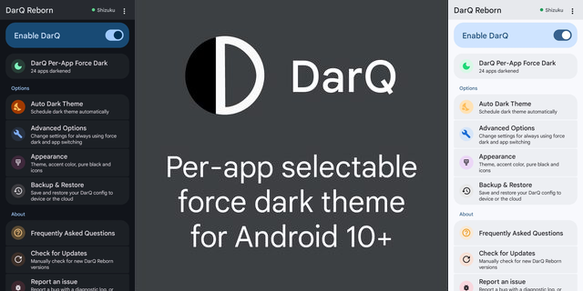
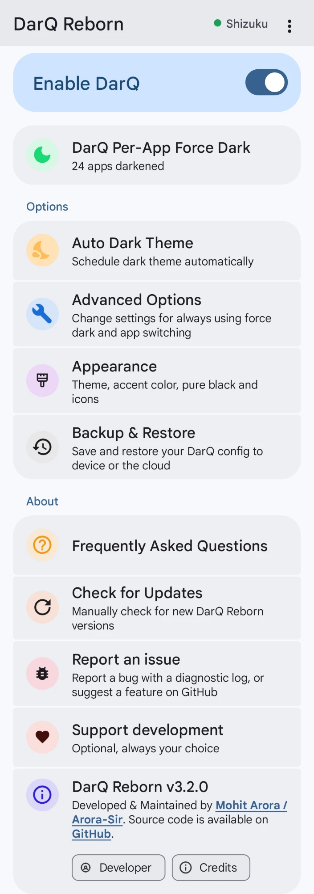
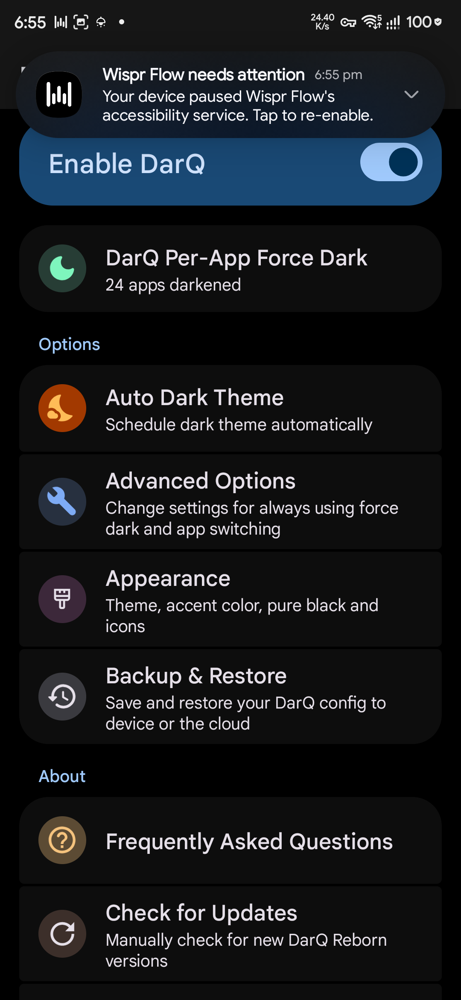
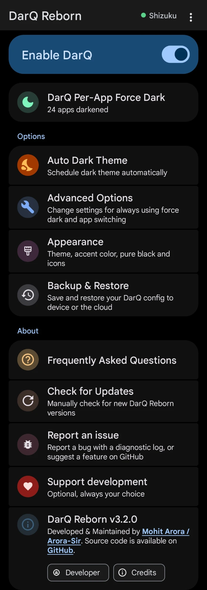

# DarQ Reborn <a href="https://github.com/Arora-Sir/DarQ-Reborn/releases"></a> <a href="https://github.com/Arora-Sir/DarQ-Reborn/releases/latest"></a>




DarQ provides a per-app selectable force dark option for Android 10 and above.

> [!NOTE]
> This is a modded fork maintained by [Mohit Arora](https://github.com/Arora-Sir). The original repository by [KieronQuinn](https://github.com/KieronQuinn/DarQ) is archived.

> [!IMPORTANT]
> **Migrating from DarQ (original) or older DarQ Reborn (pre-v3.0):**
> The package name has changed from `com.kieronquinn.app.darq` to `com.mohitarora.darqreborn`. Android treats these as two separate apps, so a one-time manual switch is required:
>
> 1. Export your settings using **Backup & Restore** inside the old app.
> 2. Uninstall the old version.
> 3. Install this version.
> 4. Import your backup from Step 1.
>
> All future DarQ Reborn updates (from this version onwards) will install as normal upgrades, no reinstall needed.

It uses a root or [Shizuku](https://shizuku.rikka.app/) (ADB) service to apply the theme seamlessly and quickly, without needing an accessibility service.

## Requirements & Setup

DarQ requires either **Root Access** or the **Shizuku** service to be running on your device to modify system theme properties.

### Shizuku Setup (For Non-Rooted Devices)
If your device is not rooted, you must set up **Shizuku** before running DarQ:
1. **Download Shizuku:**
   * **Recommended (Modded Fork):** Download and install the [thedjchi Shizuku Fork](https://github.com/thedjchi/Shizuku/releases). This version is actively maintained and highly recommended for custom, aggressive OEM skins (such as Xiaomi/HyperOS, OPPO/ColorOS, etc.) because it includes:
     * A **Watchdog service** that automatically restarts Shizuku's background process if it gets killed by the system.
     * Robust boot startup logic (e.g., waiting for Wi-Fi connection).
     * Quality-of-life patches like ADB-over-TCP settings and intent controls.
   * **Original Version:** Alternatively, you can install the original version from the [Google Play Store](https://play.google.com/store/apps/details?id=moe.shizuku.privileged.api) or the [RikkaApps Shizuku GitHub Repository](https://github.com/RikkaApps/Shizuku).
2. Open Shizuku and follow the in-app guide to start the service (using Wireless Debugging on Android 11+ or ADB command line on a computer).
3. Once the Shizuku service is running, open DarQ and grant it Shizuku access when prompted.
> [!IMPORTANT]
> **Device-Specific & Background Requirements:**
> * **Xiaomi / Redmi / POCO:** You must enable **"USB Debugging (Security settings)"** in Developer Options, and set Shizuku's Battery Saver to **"No restrictions"** in system App Info.
> * **OPPO / OnePlus / Realme:** You must enable the **"Disable permission monitoring"** (or **"Disable system optimization"** in newer builds) setting in Developer Options to prevent the OS from blocking the connection.
> * **Background Service Termination (OnePlus / Oppo / Xiaomi):** If you find that you have to manually open DarQ to make apps dark again after a while, the system has killed the background DarQ process. Go to **Advanced Options** in the app, enable **"Keep service running in background"**, and click **"Manage Notification"** to hide or minimize the status bar icon if desired.

### Xposed / LSPosed Mode Setup

DarQ works with **LSPosed 1.9.2**, its maintained forks and **Vector**. Any of them is fine, there is no need to switch managers.

If you are using the **Xposed / LSPosed** mode (to override apps that block Force Dark in code), the setup requires two steps:

1. **LSPosed Manager -> DarQ module scope**: Add the apps you want Force Dark to work on. This gives DarQ permission to inject into those app processes.
2. **DarQ app -> App picker**: Select the same apps to enable Force Dark on them, **or** enable **"Always use Force Dark"** in **Advanced Options** to skip this step and automatically apply Force Dark to everything in the LSPosed scope.

> [!IMPORTANT]
> **Do not add System Framework or System UI** to the LSPosed scope. DarQ works inside each individual app process and does not need system-level access. Adding System Framework is unnecessary and may cause system UI glitches or instability.

See the [FAQ](https://github.com/Arora-Sir/DarQ-Reborn/blob/master/app/src/main/assets/faq.md#how-should-i-configure-the-lsposed--xposed-scope-for-darq) for more detail on the LSPosed scope configuration.

### Automation & ADB Triggering (MacroDroid/Tasker/Termux)
If you use automation apps (such as MacroDroid, Tasker, or Automate) and want to start DarQ's background service externally, send a broadcast with the following details:

* **Target**: `Broadcast` / `BroadcastReceiver`
* **Action**: `com.mohitarora.darqreborn.ACTION_START_SERVICE`
* **Package**: `com.mohitarora.darqreborn`
* **Class**: `com.kieronquinn.app.darq.receivers.TriggerReceiver`
* **Flags**: `32` (`FLAG_INCLUDE_STOPPED_PACKAGES`)

> [!TIP]
> Specifying the explicit **Class** and **Flags: 32** ensures the broadcast successfully wakes up and triggers DarQ across all Android versions (Android 8.0+ through 14+) on any device, under all conditions (normal operation, background, or force-stopped).

Alternatively, you can trigger it via ADB shell or Termux:

```bash
adb shell am broadcast -a com.mohitarora.darqreborn.ACTION_START_SERVICE -n com.mohitarora.darqreborn/com.kieronquinn.app.darq.receivers.TriggerReceiver -f 32
```


### Auto Dark Theme & Scheduling

DarQ provides automated dark theme scheduling to protect your eyes when needed:

* **Schedule Modes:**
  * **Sunset to Sunrise:** Automatically switches dark theme at sunset and sunrise using location calculations or optional GPS positioning.
  * **Custom Time Schedule:** Set custom start (Dark Mode ON) and end (Dark Mode OFF) times according to your routine.
  * **Follow System Theme:** Mirrors your phone's own Dark Theme setting live, no clock schedule of its own. Reacts within moments whenever you (or another app, or an Android schedule like Bedtime/Sunset-to-sunrise) change the system theme. Requires Persistent Service, which is enabled automatically when you select this mode.
* **Schedule Targets:**
  * **System & DarQ Dark Mode:** Toggles Android System Dark Mode and DarQ Per-App Force Dark simultaneously. Currently open apps switch instantly when the boundary crosses because Android OS broadcasts system-wide `uiMode` configuration changes.
  * **DarQ Force Dark Only:** Toggles per-app force dark without altering system dark mode. The updated rendering mode applies when target apps are next launched or reopened (this prevents DarQ from force-closing active apps or interrupting unsaved work in open sessions).

> [!NOTE]
> Toggling the Auto Dark Schedule ON or OFF immediately re-evaluates current schedule conditions against the active time:
> - **Turning OFF the schedule:** Immediately restores your manual **Enable DarQ** settings and per-app force dark preferences. Under **System & DarQ Dark Mode**, your system dark mode is also returned to what it was before the schedule took control.
> - **Turning ON the schedule:** Instantly checks current time against your schedule (or location-based sunset/sunrise) and applies the correct light or dark mode state.
> - Your manual **Enable DarQ** toggle and whitelist selections are never permanently overwritten by the schedule.
> - That system dark mode restore reads Android's night mode *setting*. If your system dark theme is on **Sunset to sunrise** or **Bedtime** rather than a plain On, Android reports a schedule rather than "on", so DarQ restores light mode. See the FAQ.
> - **Follow System Theme** is unaffected by that ambiguity: it reads the currently rendered theme state directly, not the underlying setting.

Please read the Frequently Asked Questions sections in the app or [here](https://github.com/Arora-Sir/DarQ-Reborn/blob/master/app/src/main/assets/faq.md) for more information and answers.


## Appearance

Open **Appearance** in DarQ to change how the app looks.

* **Theme:** light, dark or follow the system.
* **Pure black:** true black backgrounds in dark mode, which saves power on AMOLED screens. With the switch on, tap the row to set the surface lift, a ten step slider that moves cards and fields between a flat and a lifted look while the page stays black.
* **Accent color:** match your wallpaper (Android 12 and later), pick one of the presets (Blue, Teal, Green, Purple, Orange, Rose, Amber, Mono), or tap **Custom** to mix your own with the palette, the saturation and hue sliders or a hex value. Android 10 and 11 use the preset closest to a custom color.
* **Tinted icons:** colors the settings icons with the accent instead of the classic multicolor set.

| Light | Dark | Pure black |
| --- | --- | --- |
|  |  |  |

## Check that DarQ works (DarQ Probe)

Every release has a second small app, **DarQ Probe** (`DarQ-Probe.<version>.apk`, signed with the same release key as DarQ). It shows one plain white page, so you can see at a glance whether force dark reaches an app on your device.

1. Install the probe from the release page of the version you use.
2. Open DarQ, tap **DarQ Per-App Force Dark** and select DarQ Probe.
3. Make sure **Enable DarQ** is on and the status in the title bar is green.
4. Close the probe and open it again. The page should now be dark.

If the page stays white, open **Settings > Report an issue** in DarQ and attach the log. Uninstall the probe when you are done, it has no permissions and does nothing else.

## Report an issue

**Settings > Report an issue** opens one form for a bug or a feature idea. For bugs you can type what happened and the steps, and the diagnostic log is included by default.

* The preview shows a summary, the last crash and handled errors first, and keeps the full log behind **Show full log**.
* Every app you have installed is replaced by a short code, and coordinates and email addresses are removed. You see exactly what would be sent.
* Nothing leaves your device until you tap **Continue to GitHub** or one of the other send options. GitHub opens in your default browser with the form prefilled, and the full log is copied for you to paste.
* If DarQ closes unexpectedly, the next launch offers the crash report once.

## Support, credits and updates

* **Support development:** an optional card with UPI, PayPal and GitHub Sponsors. There are no popups or nag screens.
* **Credits:** DarQ Reborn continues the original [DarQ](https://github.com/KieronQuinn/DarQ) by Kieron Quinn and builds on Shizuku, LSPosed, libsu and other open source projects.
* **Updates:** DarQ checks GitHub for new releases, and **Track with Obtainium** adds it to [Obtainium](https://github.com/ImranR98/Obtainium) in one tap.

## Known Behaviour

**Samsung Pop-up View title bar.** If you summon a Pop-up View window within the first few seconds of launching an app you have selected in DarQ, that pop-up's title bar can appear white. Opening a pop-up at any other time is unaffected, and the app itself is always correctly darkened.

This is not a bug that can be fixed in Shizuku mode. Samsung's pop-up title bar reads the same system-wide force dark switch DarQ uses, and Android samples that switch once per window at creation time. For those few seconds the app being launched needs it on while the pop-up being created needs it off, and there is only one switch. DarQ does not try to work around it, because forcing the switch off early to satisfy the pop-up makes the app you just opened render in its light theme instead, which is far more noticeable. Waiting a moment before summoning the pop-up avoids it, and Xposed/LSPosed mode is immune because it hooks each app process individually rather than sharing one global switch.

See the [FAQ](https://github.com/Arora-Sir/DarQ-Reborn/blob/master/app/src/main/assets/faq.md) for the full explanation.


## Troubleshooting & Bug Reporting

Open **Report an issue** in DarQ settings. It takes what happened and the steps, adds a redacted diagnostic log you can review first, and opens a prefilled GitHub form in your browser with the full log copied for you to paste. If DarQ closes unexpectedly, the next launch offers the saved crash report once.

If DarQ cannot start at all, capture a log on the device instead:

1. Install an open-source log viewer like [**LogFox**](https://github.com/F0x1d/LogFox) and grant it Shizuku access.
2. Start recording logs, launch DarQ Reborn to trigger the problem, and copy the captured logs from the notification pop-up.
3. Share the log in your GitHub issue.

[Download from GitHub Releases](https://github.com/Arora-Sir/DarQ-Reborn/releases)
